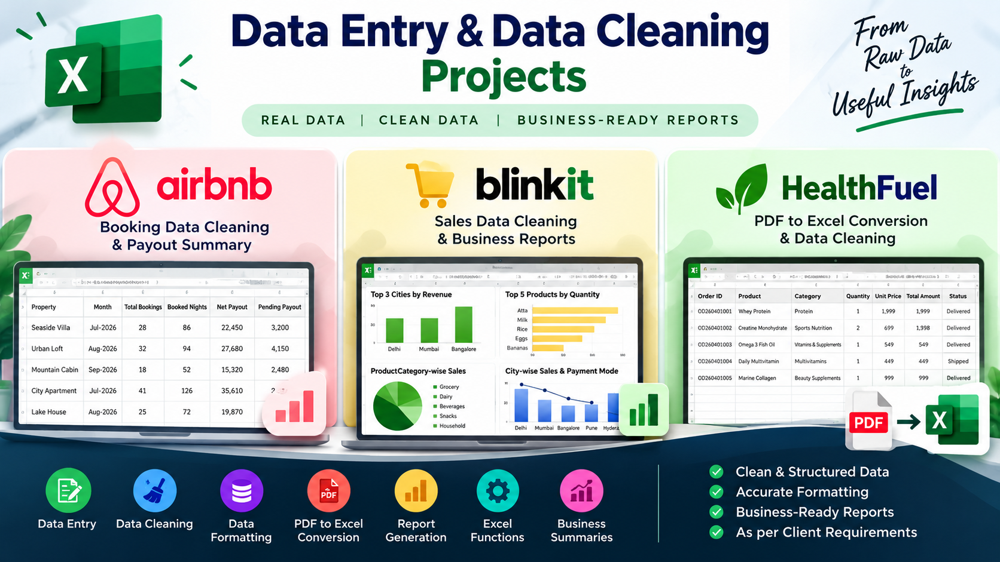

<p align="center">
  
</p>

<h1 align="center">Data Entry, Data Cleaning & Excel Reporting Portfolio</h1>

<p align="center">
  <b>Clean Data • Accurate Formatting • Business-Ready Reports</b>
</p>


<p align="center">
  
  
  
  
  
  
</p>


## Overview

This repository showcases three practical data management projects involving data entry, data cleaning, Excel formatting, reporting, and PDF-to-Excel conversion. The goal is to transform raw or messy source data into clean, structured, and useful reports.

## Projects

### 1. Airbnb Booking & Payout Summary

<p>
  
  
</p>


**Source:** Excel workbook

**Work completed / project scope:**
- Complete data entry and data cleaning for July–September 2026.
- Standardize column names and formatting.
- Prepare monthly summaries for five properties, including booked nights and net payout.
- List properties by pending net payout in descending order.

**Workbook sheets:** `Clients Requirement`, `Raw Data - Jul - Sep`, `Clean Data Jul - Sep`, `Pivot Table`

### 2. Blinkit Sales Reporting — HomeKart Supplies

<p>
  
  
</p>


**Source:** Excel workbook

**Work completed / project scope:**
- Complete data entry and data cleaning.
- Identify the top three cities by revenue.
- Identify the top five selling products by quantity sold.
- Summarize product-wise, category-wise, and city-wise sales.
- Analyze revenue by payment mode.

**Workbook sheets:** `Clients Requirement`, `BlinkIt Data`, `Clean Data`, `Pivot Table`

### 3. HealthFuel India — PDF to Excel Conversion

<p>
  
  
</p>


**Source:** PDF order details and Excel requirements workbook

**Work completed / project scope:**
- Convert order details from a PDF into Excel.
- Clean and structure messy source data.
- Prepare a weekly sales trend.
- Identify the ten least-selling products.

**Workbook sheets:** `Clients Requirement`, `PDF messy data`, `PDF Clean Data`, `Pivot Table`

**Reporting-period note:** The source PDF title refers to Q1 2026, while visible records include April dates. The reporting period should be verified before treating the dataset as Q1-only.

## Skills Demonstrated

- Data entry and validation
- Data cleaning and structuring
- Excel formatting
- PDF-to-Excel conversion
- Pivot tables and summary reporting
- Sales and payout analysis
- Business-focused reporting

## Tools

- Microsoft Excel
- PDF data extraction and spreadsheet formatting
- GitHub for project documentation and portfolio presentation

## Repository Structure

```text
data-entry-cleaning-portfolio/
├── README.md
├── project-cover.png
├── AirBnB_Data.xlsx
├── BlinkIt_Data_HomeKart_Supplies.xlsx
└── HealthFuel/
    ├── HealthFuel_Order_Details_Q1_2026.pdf
    └── HealthFuel_Requirement.xlsx
```

*Update the filenames above to match the actual files you upload. Add the final cleaned HealthFuel workbook if it is a separate file.*

## Workflow

1. Review source data and client requirements.
2. Enter or extract the data.
3. Clean inconsistencies and standardize formatting.
4. Organize the cleaned data into structured worksheets.
5. Create summaries and reports based on the requested business questions.
6. Document the project and publish the files in GitHub.

## Purpose

This portfolio demonstrates a practical, detail-oriented approach to handling raw data and preparing clear, organized Excel reports that support business review and decision-making.

---

<p align="center">
  <i>Data Entry · Data Cleaning · Excel Reporting · PDF-to-Excel Conversion</i>
</p>
